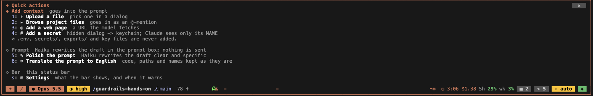
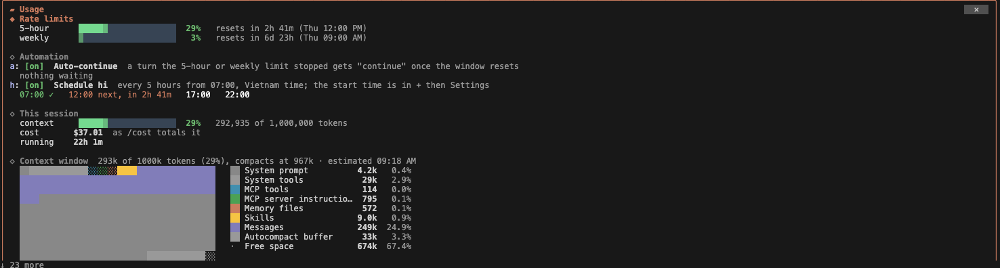
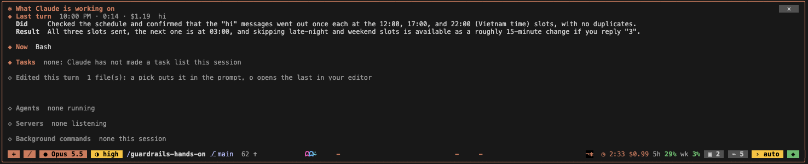
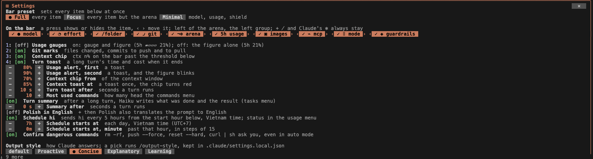

# cc-mod-statusbar

A Claude Code mod that draws a clickable status bar in the band above the prompt, in any project.




The screenshots are from the VS Code terminal, dark theme. Paths that pointed at a private folder are blanked out in the tasks menu.

| Item | Shows | Its menu |
|---|---|---|
| `+` | | Three groups. Add context: upload a file (a macOS file dialog), browse the project's files, add a web page, add a secret (the same dialog as `/secret`); files go into the prompt as `@` mentions, and `.env*`, `secrets/`, `exports/` and key files are shown locked and are not added. Prompt: Polish (5) and Translate (6) send the prompt box's draft to Haiku; Polish rewrites it clear and specific, keeping every fact, path and command (in English with `polishEnglish` on), and Translate puts it in English with code, paths and names kept. The rewrite replaces the draft and is never sent; Put back (7) restores the draft. Bar, last: Settings (`s`) |
| `⁄` | | Every slash command and skill, grouped: the ones you type most first (counted across sessions; 5 by default, up to 10 in Settings), then this mod, then other plugins, your skills and commands, MCP, built-in. A pick puts `/name ` in the prompt A press on a group's heading folds it away or opens it again, and the folds are kept across sessions. A list taller than the band scrolls with the wheel, or with ↑ and ↓ while the band holds the keyboard; it opens scrolled to the bar A search field heads the list: words typed there keep the commands whose name or description holds them all, across folded groups, and Enter puts the first match in the prompt |
| `● model` | the session's model, its dot in the family's color | Opus, Sonnet, Haiku, Fable. A pick runs `/model <alias>`, which also makes it your default for new sessions |
| `◔ effort` | the effort the main loop's requests go out with, from the settings' `effortLevel` until the first turn | `○` low, `◔` medium, `◑` high, `◕` xhigh, `●` max: the circle fills and the color warms from green to red as the thinking grows. A pick runs `/effort <level>`, which also makes it your default for new sessions |
| folder | the session's folder after a slash (`/guardrails-hands-on`) and, inside a git repository, its branch after `⎇` (none on a detached HEAD), then `✎n` files changed, `⇡n` commits to push and `⇣n` commits to pull | The changed files with their git status code; a pick puts the file into the prompt as an `@` mention, and secret files are shown locked. Read every 5 seconds |
| gauges | the 5-hour and the weekly rate-limit windows, five cells each with the figure inside: the whole fill in one color by the figure: green, amber from 50%, red from 80% | A window that passes 80% shows a toast once, and again at 90%; past 90% its figure on the bar blinks. Past 70% of the context window a `ctx n%` chip shows at the head of the usage button, before the gauges (red from 85%, with a toast once); it opens this menu, whose last line runs `/compact`. The menu shows every rate-limit window with a 20-cell gauge and when it resets, the context window in tokens, the session's cost as /cost totals it, and how long the session has run. Below, what fills the context window, as `/context` breaks it down: the heat map `/context` draws (10 by 10 squares of 1% each, 20 by 10 for a window of a million tokens or more), each square in its category's color, filled at 70% and over, `░░` under it, `⋅` for free space, beside a legend of the categories (system prompt, tools, MCP tools, memory files, messages, free space, the autocompact buffer) with their tokens and share, the tool schemas loaded on demand outside the window, the memory files with their tokens, the MCP tools grouped by server (tools, loaded, tokens), the agents, and the skill and command listings. Opening the menu estimates it locally and sends nothing; `x` counts it exactly with token-count requests, as `/context` does. The engine pushes a new reading (`session.measure`) whenever a window moves a whole point, the same figures as Claude Code's footer; the bar also reads them every 5 seconds and shows `–` until an API response has reported them |
| `▣ n` | the images pasted this session, shown from the first one | Each `[Image #n]` with its time, size and the prompt it came with; a press or its digit opens it in Preview, `@` beside it puts it in the prompt as an @-mention for Claude to look at again, `✕` deletes its file and Delete all deletes every one (each after a second press within 5 seconds; what the conversation already holds of an image stays), and the last row opens the folder in Finder |
| `⌁ n` | the MCP servers connected now, read from the tool list; red with `✘n` when the last check found servers that failed | The connected servers with their tool counts and this session's calls and failed calls, the claude.ai connectors that need a sign-in, and the servers that failed at the last check with the reason. `c` runs `claude mcp list` (about 12 seconds, it dials every server); it keeps a stdio server's executable name and drops the rest of its command line, which may carry a key. `m` opens `/mcp` to sign in, reconnect or turn a server off |
| `mode` | the permission mode with Claude Code's icon color, read every second from the permission checks (`$.tool.check` on a dry Edit and Bash; nothing runs, no dialog opens), because the hint line can be a frame behind | A pick of plan runs `/plan`. A mod has no call that sets the other modes, so a pick shows a toast with the number of shift+tab presses (the cycle is manual, accept edits, plan, auto) |
| `◈ n/3` | how many of three checks pass: deny rules exist, settings hooks exist, the mode is not bypass; with all three passing, `◈` alone. It follows the settings with its menu shut: read again as soon as Claude Code reports a settings file changed, and every 5 seconds besides. The sandbox is advised but optional: the menu shows it off as a yellow warning and the score leaves it out. The menu opens with the same score, then, under "To fix", what would make each failing check pass: `d` adds the suggested deny rules (`.env`, `.env.*`, `secrets/`, `exports/`, `*.pem`, `*.key`, `~/.ssh`, `~/.aws`), `h` adds an audit hook (PreToolUse on Bash, each call appended to `.claude/audit.jsonl`; it records and blocks nothing), `k` opens `/hooks` to write your own, `m` opens the mode menu when the mode is bypass, and `x` opens `/sandbox` while the sandbox is off. A fix that writes `.claude/settings.local.json` takes a second press within 5 seconds. Below, it marks only the three scored checks pass or fail, and draws the other figures (ask and allow rules, plugins, saved secrets) with a dim dot. Under "Asked most" it lists the three rules that would have skipped the permission prompts you answered most (the engine's own suggestion, counted across sessions); pressing one twice within 5 seconds adds it to `permissions.allow` in this project's `.claude/settings.local.json`. Its last part lists this session's guardrail events, newest five: secrets saved, used or deleted, and in red what was blocked or masked | The deny, ask and allow rules, the sandbox, the hooks and the enabled plugins as the merged settings have them, the saved secret names, and a button for `/permissions` Its Network list shows every host the session reached, the main loop's and its agents': the host of a WebFetch or `secret_fetch` URL, the URLs and `user@host` (ssh, scp, git) in a Bash command, a remote MCP server by name, and WebSearch as one row, each with its call count, the calls a guard refused, and the tools that made them |



While Claude works, the empty middle of the bar plays a small arcade: monsters (each in a random color). Every tool call sends its own monster: Bash `ᗣ`, Edit and Write `Ѫ` (two hits), Read, Grep and Glob `⍤`, an MCP tool `Ӝ`, an agent `Ѯ`, a web tool `ᘛ`, anything else `⍨`; with no tool call for 4 seconds, monsters of the arena's own walk in at random intervals (0.5 to 3 seconds apart), each at its own random speed, and every 10 kills a slow boss (`Ѭ`, five hits) that bursts three cells wide. Claude (`¬✻`) at the right end fires `-` bullets at the monsters it has seen for a moment, and each kill bursts as `✺`. The number at the left counts the kills of this turn. The turn's clock and what it has cost so far (`◷ 1:12 $0.08`) head the right group, before the gauges. A turn of 10 seconds or more ends with a toast of its time and cost. The arena sizes itself to the gap, and when the prompt goes idle the monsters left burst, Claude stays on the field for 3 seconds, then the monsters and the count clear. Claude itself always stays at the right end of the gap (grey while idle), so its menu opens at any time; when the gap is under 16 cells Claude moves to the head of the right group. A number after Claude (`¬✻2`) counts the agents and the servers running for it, read every 5 and 10 seconds with the menu shut. A click on Claude opens what it is working on: after a turn of 60 seconds or more, a Last turn block first, where Haiku sums up what was done and how it came out (Did, Result) from the request, the tools run, the files changed and Claude's last message; then the tool it runs now, its task list (from `TaskCreate`, `TaskUpdate` and `TodoWrite`, and `TaskList` when the engine answers it) marked done, in progress or pending, the files the main loop wrote this turn with the lines added and removed (a pick puts one into the prompt, `o` opens the last one in VS Code or the default app), the agents still running, and the servers Claude started: every TCP port in LISTEN held by a process under this Claude Code process (a dev server from a background Bash, an MCP server), read with `ps` and `lsof` every 5 seconds while the menu is open. A click on a server opens `http://localhost:<port>`; a server started outside Claude stays out. The menu refreshes every second while it is open. A failed tool call sends a red boss `Ж` (the orange `Ѭ` is the boss that comes every 10 kills, and bullets do bring that one down) that bullets do not touch: it waits in front of Claude until the next call succeeds, and then bursts. A task marked done fires a volley that clears the field. A monster that gets through to Claude bursts on the gun as a hit: Claude shows red for about a second and the count reads `12 ✝ · 2 ✗`; the error boss never gets that close.

A click on the bar gives it the keyboard without highlighting `+`: the focus ring starts on nothing, and Tab moves it onto the items. A click on an item, or ctrl+x tab and Enter, opens its menu upward inside the frame; the same item or `✕` closes it. Escape hands the keyboard back to the prompt and leaves the menu open: a mod cannot catch Escape in the band. Inside a menu the digits press the entries. The `[-]` at the frame's right is Claude Code's own control for collapsing a plugin's band (also ctrl+x ctrl+a).

## In Claude Code for VS Code

The bar is not drawn in the extension's panel: the panel draws every button as its own bright native button whatever colors the mod asks for, and nothing drawn there came close to the terminal's look. The hooks still run there: the dangerous-command check, the vault, the guardrails readings, auto-continue and the `hi` schedule.

## On a narrow terminal

When the full bar would leave the arena fewer than 16 cells, the bar switches to its compact labels: the model as `S5.5`, the mode as its icon alone, the effort as its first letter, folder and branch cut to 14 characters, and the usage figures without gauges. If even the compact bar leaves no room, the arena steps out and Claude stands at the head of the right group. Either way the bar stays on one row.

## The tasks menu



Claude's `¬✻` opens it: the last long turn's summary, what runs now, the task list, the files edited this turn, then:

- **Agents**: those running, then the last three that finished. A press opens one: the tools it called, in order (the last eight), and its answer once it ends. The mod keeps these from the agent's own tool calls and turn end, for this session (a reload starts the record over).
- **Servers**: the ports Claude's processes listen on, each asked over HTTP every 30 seconds whether it still answers (`✓ 200`; red when it does not answer or answers 5xx: `✘ no answer`, `✘ 502`; a server that is not HTTP answers nothing), each with its framework when its command line or the command that started it names one (Vite, Next.js, Django, Uvicorn, http.server and twenty more); a press opens one in the browser. A server that came from a command Claude left running in the background has a `log` chip beside it.
- **Background commands**: the last five Claude left running this session, each with its state (running, completed, failed, killed: the engine's task notification says how one ended). A press shows the last 15 lines of the command's log, the session's `tasks/<id>.output`, read again each time the menu redraws; `@` puts those lines in the prompt, `follow` keeps the newest lines in view (redrawn every second, as `tail -f`; shutting the log stops it), and `errors only` keeps the error lines alone. Each row counts its log's error lines (`3 errors`, from its last 200 lines); one that ended has `↻ rerun`, which runs the same command in the background again, through Bash as Claude would. Under a row: the addresses a running command printed (a dev server's Local and Network lines), each a press away in the browser; `? ask Claude` on one that failed or logged errors, which sends Claude its error lines and last lines to find the cause and fix it; and, when it could not listen (`EADDRINUSE`), the port and the pid that holds it now, with a `■ stop` for that pid. `■ stop` stops a running one through the engine's TaskStop, after a second press within 5 seconds; a server gets one too (a server no background command accounts for is stopped by its pid).

A background command that fails, or whose log shows an error line (`Error`, `Exception`, `Traceback`, `EADDRINUSE`, `failed`, `fatal`, `panic`; the logs are read every 5 seconds), turns a red `✘ npm run` chip on the bar; a press opens the tasks menu on its log, and the chip goes once seen.

## Settings



`+` then `s` (Settings) opens these rows. A digit or a click flips a switch, `−` and `+` step a number, `r` puts every row back to its default. Every change keeps the settings it replaced (the last 20, across sessions); `u` (Undo the last change) puts the one before back. The values are kept in this mod's store, for every session. `c` (Copy the settings) puts them on the clipboard as JSON, the bar's order included; secrets stay in the keychain and never go with them. On another machine, copy that JSON and press `p` (Paste settings): it replaces the settings in force, a key it lacks gets its default, and `u` brings the earlier ones back. Text that holds no settings changes nothing.

**Bar preset** heads the menu: three presets set every item at once, Full (all of them), Focus (all but the arena) and Minimal (model, usage, shield); the one the switches match is marked. **On the bar** follows: one chip per bar item (model, effort, folder, git, arena, usage, images, mcp, mode, guardrails), all on by default. A press hides the item and gives its cells to the arena; `+`, `⁄` and Claude's `¬✻` always stay. With the arena off, Claude stands at the head of the right group. The chips are listed in bar order, and the `‹` and `›` beside each one move it a place left or right. The arena chip divides the two groups, so an item moved past it changes sides. The folder and the branch share one button while nothing shown stands between them, and split into two once something does. Presets switch items on and off but keep your order.

| Row | Default | What it does |
|---|---|---|
| `usageGauge` | on | The gauges beside `5h` and `wk`. In the terminal each is 5 cells with the figure inside it, dark on the fill and light on the track; elsewhere the `▰▱` text and the figure after it. Off, the bar shows the figures alone (`5h 21% wk 36%`) |
| `gitMarks` | on | `✎n ⇡n ⇣n` after the branch |
| `ctxChip` | on | The `ctx n%` chip on the bar |
| `turnToast` | on | The toast with a long turn's time and cost |
| `usageAlertLow` | 80 | Percent of a rate-limit window that shows the first toast |
| `usageAlertHigh` | 90 | Percent that shows the second toast and makes the figure blink |
| `ctxChipAt` | 70 | Percent of the context window that shows the chip |
| `ctxToastAt` | 85 | Percent of the context window that shows a toast once, and turns the chip red |
| `turnToastSeconds` | 10 | Seconds a turn must run before its end shows a toast |
| `topCommands` | 5 | How many of the commands you type most head the `⁄` menu, from 5 to 10 |
| `turnSummary` | on | The Last turn summary in the tasks menu: one Haiku request after each turn that runs `summarySeconds` or more |
| `summarySeconds` | 60 | Seconds a turn must run before it gets a summary |
| `polishEnglish` | off | `+` then Polish writes the prompt in English as well |
| `autoContinue` | on | Switched in the usage menu (`a`). A main-loop turn that the 5-hour or weekly limit stopped gets `continue`, sent as your prompt, a minute after the window that ran out resets (both ran out: the later reset; no reset time known: 30 minutes on). It is told apart by the StopFailure hook's `rate_limit`, or, when that hook does not reach this mod, by a turn that ended on an API error with a window at 100% or the limit's message in its answer. It never goes into a running turn; a `continue` the limit stops again waits for the next reset, up to 5 tries. While one waits the bar shows `⏵ 14:20` before the gauges, and the usage menu says when, after which window, with a cancel |
| `hiSchedule` | on | Sends `hi` as your prompt every 5 hours from `hiStartHour`, Vietnam time (UTC+7, whatever the machine's zone): 07:00, 12:00, 17:00, 22:00, so a usage window starts on the hour. One `hi` a slot across every open session (the slot is kept in this mod's store). A slot that comes during a turn is skipped, as the window is in use; one missed by more than 30 minutes (Claude Code not running) is not sent late. The usage menu (`h` switches it) shows today's slots: `✓` sent, in use, missed, failed, and the next one with the time left |
| `hiStartHour` | 7 | The hour of the schedule's first slot each day, 0 to 23, Vietnam time |
| `hiStartMinute` | 0 | Its minute: 0, 15, 30 or 45. With 7 and 30 the slots are 07:30, 12:30, 17:30 and 22:30 |
| `dangerConfirm` | on | A dangerous Bash command asks you in Claude Code's question dialog before it runs, in any mode, auto and bypass included: `rm -rf` (any spelling of the two flags), `git push --force` (`-f`, `+branch`; `--force-with-lease` passes), `git reset --hard`, `git clean -f`, `git branch -D`, `curl` or `wget` piped into a shell, and `mkfs` or `dd of=/dev/…`. A subagent's commands ask too. Where Claude Code will ask you anyway (manual, accept edits or plan mode with no allow rule) its own prompt is the only one; a command the rules deny is not asked about. If the dialog cannot open (dismissed, a `-p` run) the command is refused. Each one caught counts on the shield chip after its score (`◈ 2/3 ⚠1`, the `⚠1` in yellow) and goes into the shield menu's event list: allowed, or in red refused |
| `selfRemote` | off | The `⇄` chip at the head of the right group, which opens Self remote (below) |
| `remoteIdleMinutes` | 30 | Minutes with no phone watching before the remote stops, from 5 to 240 |

The Settings menu ends with the output style: the styles `/config` offers (default, Explanatory, Learning, Concise and your own), and every `.md` in `~/.claude/output-styles` and the project's `.claude/output-styles`. The one in force is marked; a pick runs `/output-style <name>`, which keeps it in the project's `.claude/settings.local.json`.

## Self remote

Its two rows have a group of their own in Settings, after the other rows and before the output style. With `selfRemote` on, `⇄` on the bar opens a menu that puts every Claude Code session on this machine on your phone or another browser. Start takes a second press within 5 seconds. It runs one hub for the machine (`remote/server.mjs`, in Node, started in the background so it outlives the session that started it) and one Cloudflare quick tunnel to it, so it needs `node` and `cloudflared` (`brew install cloudflared`); a quick tunnel needs no Cloudflare account. The menu then draws a QR code of the link. It shows the code about 15 seconds after Start, once Cloudflare's resolver knows the tunnel's new name, because a phone that asks too early caches the miss.

Every session with the setting on joins the hub and sends it a snapshot every 2 seconds: the folder and branch, the model and mode, the turn's prompt, the tool running and the tools run, the task list, the last turn's summary, the last 30 messages, the files edited this turn and the files git reports changed, the pasted images, and the usage figures. On the phone the page reads as a chat: your messages in bubbles on the right, Claude's on the left, and each tool call as one line (a press opens what it gave back, or an edit's diff). One line heads it: the drawer of sessions, the session's name (a press shows its branch, model, mode, usage and cost) and a button that opens the files (a press shows the file's diff against HEAD) and the images. A text sent from the phone goes into that session as your prompt; one sent while Claude works waits and goes in when the turn ends, one a turn. When a main-loop turn ends, or Claude waits for you (a permission prompt), every phone that turned on notifications gets a push. On an iPhone that needs the page added to the Home Screen first (iOS 16.4 or later).

The link alone does not let anyone in. It carries a random 256-bit key after `#`, which the browser never sends to Cloudflare as part of the address. A phone that opens it is held with a 4-character code (letters and digits) until you press Allow beside the same code in a terminal; only then does it get a cookie, HttpOnly and SameSite=Strict. Every other request without that cookie is refused. Ten wrong keys lock pairing until the remote starts again, at most five phones stay paired, `f` forgets them all, and a stop or a restart makes a new key and a new address. The phone sees only what the snapshots hold: a diff is served only for a file a session lists, and an image only from the session's own images folder. The hub talks to the sessions over a Unix socket in `/tmp/qsb-remote-<uid>`, which only your user can open.

`h` takes this session off the phone's list and leaves the others. `x` stops the hub for every session, after a second press. The hub also stops by itself when no session has called in for two minutes, or no phone has watched for `remoteIdleMinutes`. Its log is `/tmp/qsb-remote-<uid>/hub.log`. Quick tunnels carry at most 200 requests at once and no server-sent events, so the page asks again (a long poll) and gets each change within a second or two. Each start has a new address, so a page saved to an iPhone's Home Screen works until the remote stops.

## Claude's questions

When Claude calls AskUserQuestion, the mod answers the call itself and the engine's dialog does not open. The band opens a `? Claude asks` menu instead, with every question at once: each with its options (`( )` for one choice, `[ ]` for several; a digit picks the first nine), the preview of the option picked, and an Other box for an answer of your own. `s` submits and `d` dismisses; a question left blank is left out, and Claude reads the answers in the dialog's own words. Shut the menu and a `? Claude asks` chip on the bar opens it again. With Self remote on, the phone shows the same questions on a page of their own and gets a push; the first answer in, from the Mac or the phone, is the one Claude gets, and the other side closes. Where no band draws (Claude Code for VS Code, a `-p` run), or while another question waits, the engine's dialog asks as before. While a question waits, the hook sleeps in short `sleep` commands, as a hook's own time is capped at 10 seconds and a `$` call does not count against it.

## Secret vault

`/secret [NAME]` asks for the value in a hidden macOS dialog (zenity on Linux) and stores it in the OS keychain under the service `cc-mod-statusbar-vault`. A known prefix (`figd_`, `ghp_`, `glpat-`, `xoxb-`, `sk-ant-`, `sk-`) names the secret and binds it to its API host. Any other value asks for a name, a host and a header. `/secrets` lists names and hosts, never values, and `/secret-forget NAME` deletes one.

Claude sees only the NAME. It calls `secret_list`, `secret_request` (opens the dialog) and `secret_fetch` (an HTTPS call that sends the secret only to its bound host and scrubs it from the response). After a WebFetch or WebSearch, `secret_fetch` allows GET only. A Bash command that names the keychain service or contains a saved value is refused. A token pasted into the prompt is saved and replaced by `[secret:NAME]` before the model gets the prompt.

The NAME-to-host bindings live in this mod's own store; the values stay in the keychain.

## Install

The repository is its own marketplace. Type this at the prompt of a terminal session, answer `y` to add the marketplace, then pick a scope:

```
/plugin install cc-mod-statusbar --marketplace nmquan2504/cc-mod-statusbar
```

The repository is private, so the account running Claude Code needs read access to it on GitHub. A copy installed this way updates through `claude plugin update cc-mod-statusbar`, then `/reload-plugins`.

## Where it lives

The author's copy sits in `~/.claude/skills/cc-mod-statusbar/`, a clone of the repository, so every session loads it as `cc-mod-statusbar@skills-dir`. A minute after a session starts, and every hour after that, the mod fetches its own repository. When the upstream has commits this folder lacks, a `↑ mod` chip shows at the head of the right group. A press asks first, then runs `git pull --ff-only`, so a local change is never merged over; `/reload-plugins` loads the new code. A folder that is not a git clone, such as a marketplace install, never shows the chip.

```bash
claude plugin disable cc-mod-statusbar@skills-dir   # turn it off
claude plugin enable cc-mod-statusbar@skills-dir    # turn it back on
claude plugin validate ~/.claude/skills/cc-mod-statusbar
claude plugin test ~/.claude/skills/cc-mod-statusbar
```

Every lifecycle hook fails open: if the bar breaks, prompts and turns carry on and Claude Code draws the band without it.

## Files

```
.claude-plugin/plugin.json      manifest
.claude-plugin/marketplace.json makes the repository a marketplace that lists this one mod
hooks/hooks.json                names the one entry module
hooks/register.tsx              the entry: registers the hook groups below, in their old order
hooks/events/                   the hooks, one file per group: session, tools, secret-tools, prompt,
                                turn, commands, permissions, settings-hooks, ui
hooks/ui/band.tsx               the band in the terminal: the bar, the arena, the menu above it (none in VS Code)
hooks/ui/menus/                 one file per menu (add, commands, model, effort, git, usage, mcp,
                                mode, guard, tasks, settings, images, files, web, automation, remote,
                                ask);
                                index.tsx picks one, entry.tsx is the row most of them list
hooks/features/                 what the menus and hooks do: vault, guard, permissions, usage,
                                automation, arena, mcp, work, images, commands, assist, mode,
                                status (the bar's readings), menu, egress, audit, edits,
                                update (the mod's own new commits), remote (Self remote), ask (Claude's questions)
hooks/lib/                      plain helpers: format, graphics, catalog (models, modes, efforts),
                                danger, schedule (Vietnam time), qr (the QR encoder)
hooks/state/                    runtime.ts (the values the hooks share), config.ts (the settings)
types/index.d.ts                the state contract
tests/statusbar.test.tsx        the bar, its menus and settings, both surfaces
tests/vault.test.ts             the vault, the Bash guard, the mode menu
tests/remote.test.tsx           Self remote (the QR code, the chip, Start, pairing) and Claude's questions
remote/                         Self remote's hub (server.mjs) and the phone's page (app.html, app.js, sw.js)
docs/                           the README's screenshots
```

Two rules of the engine shape the split. `read($, x)` and `update($, x)` take only an atom a const of the same file made, so each file declares the atoms it uses (the same plugin and key are the same value). And `$` passes from file to file only as an argument to a function declaration, never inside an object or through a function held in a const.
